<div align="center">



# Cyberpunk Themes for Claude Code

**Seven pixel-art cyberpunk worlds behind your conversation, one command to switch.**

Each theme pairs an animated scene with a matching colour palette for the whole app, in the Claude Code desktop app's Code tab.

[](CHANGELOG.md)
[](LICENSE)
[](https://code.claude.com/docs/en/plugins/mods/overview)
[](#themes)
[](#accessibility)
[](https://github.com/nocashflow/claude-cyberpunk-themes/actions/workflows/audit.yml)

[Install](#install) · [Themes](#themes) · [Usage](#usage) · [Accessibility](#accessibility) · [Security](#security-and-privacy) · [How it works](#how-it-works)

</div>

---

## Install

In the Claude Code desktop app, type this in the message box:

```
/plugin install cyberpunk-themes --marketplace nocashflow/claude-cyberpunk-themes
```

Answer `y` to add the marketplace, then pick a scope (**user** puts the themes in every project). Then pick a theme:

```
/neon rooftop
```

> [!NOTE]
> **Requirements:** the Claude Code desktop app (Code tab), Claude Code v2.1.324 or later. The terminal draws no backdrop, so there you get nothing. If another backdrop theme is on, such as the example plugin's `/custom-theme`, turn it off first: two backdrops compete.

## Themes

<table>
  <tr>
    <td colspan="2" width="66%">
      
      <br><b>Neon Rooftop</b> &nbsp;<code>/neon rooftop</code>
      <br><sub>Purple · dark mode. A pixel city in soft neon. Two mascots watch the moon from a rooftop while an ad blimp drifts by and a hologram eye looks around.</sub>
    </td>
    <td width="33%">
      
      <br><b>Phosphor Alley</b> &nbsp;<code>/neon alley</code>
      <br><sub>Green · dark mode. Rain, an LED umbrella on a power line, a hologram jellyfish and a cat on the AC unit.</sub>
    </td>
  </tr>
  <tr>
    <td width="33%">
      
      <br><b>Deep Net</b> &nbsp;<code>/neon net</code>
      <br><sub>Blue · dark mode. Inside cyberspace: a netrunner breaches a wall of ICE.</sub>
    </td>
    <td width="33%">
      
      <br><b>Ripperdoc</b> &nbsp;<code>/neon clinic</code>
      <br><sub>Green · dark mode. A back-alley clinic: a doc fits a chrome arm under the lamp.</sub>
    </td>
    <td width="33%">
      
      <br><b>Badlands</b> &nbsp;<code>/neon badlands</code>
      <br><sub>Orange · dark mode. Nomads by their car under a striped sun.</sub>
    </td>
  </tr>
  <tr>
    <td colspan="2" width="66%">
      
      <br><b>Blackwall</b> &nbsp;<code>/neon blackwall</code>
      <br><sub>Black · dark mode. The edge of the Net. Red eyes open in the cracks, a rogue AI's mask glitches, and something huge waits in the haze.</sub>
    </td>
    <td width="33%">
      
      <br><b>Corpo Plaza</b> &nbsp;<code>/neon corpo</code>
      <br><sub>White · <b>light mode</b>. A pristine plaza under a red hologram, petals on the wind.</sub>
    </td>
  </tr>
</table>

Every scene is animated, and every theme also recolours the app: panels, text, links, code and diffs. The previews above are the actual scenes the plugin draws.

<details>
<summary><b>What's in each scene</b></summary>

| Theme | Look for |
| --- | --- |
| **Neon Rooftop** | A megacorp tower with sweeping searchlights, flying cars with light trails, an LED ad blimp, a hologram eye billboard, signs in an invented pixel script, a train, rain, and a heart that rises between the two mascots now and then. |
| **Phosphor Alley** | A hologram jellyfish that glitches, an LED umbrella, pigeons and sneakers on the wires, a cat on a humming AC unit, a noodle-shop sign with steam, a netrunner's screen in a window, a vending machine, rain rings in the puddles. |
| **Deep Net** | A wireframe grid that flows toward you, data towers with a climbing scan, a hexagon ICE wall with a pulsing breach, packets streaming to the netrunner, a headset cable rising into the sky, a daemon program, turning wireframe solids. |
| **Ripperdoc** | A CRT heart monitor at 72 bpm, a pegboard of spare chrome, jars of floating cyber-eyes with bubbles, a humming green cross, a surgical lamp, an IV drip, sparks where the doc's tool meets the chrome arm. |
| **Badlands** | A striped sun, layered mesas, wind turbines, an elevated highway with streaming tail-lights, an abandoned motel sign with a chasing arrow, a dust devil, the city far on the horizon. |
| **Blackwall** | A wall of code, red cracks with eyes that open, a glitching red mask, a giant armoured silhouette with a visor slit, a red security scan, a hooded runner and their drone. |
| **Corpo Plaza** | Glass towers, a turning red hologram emblem, a stock ticker, a red banner, a pixel cherry tree, drifting petals, a security drone with a scan cone, a corpo with a briefcase and a security bot. |

</details>

## Usage

| Command | What it does |
| --- | --- |
| `/neon` | Lists the themes. |
| `/neon <theme>` | Switches to a theme: `rooftop`, `alley`, `net`, `clinic`, `badlands`, `blackwall` or `corpo`. |
| `/neon off` | Goes back to the app's own look. |

Your choice is remembered across sessions. A chat that was open before you installed or switched needs `/reload-plugins` once, or a message, before its scene appears.

> [!TIP]
> The characters sit in the space between the conversation and the right-hand side panel, so they stay in view with the side panel open.

## Accessibility

Every theme is checked by [`scripts/audit.mjs`](scripts/audit.mjs) on every push.

- **Text contrast:** body text is at least **13:1** on every surface in every theme, beyond WCAG AAA (7:1). Secondary and muted text are at least **6:1** (AA is 4.5:1). Claude Code's own design-system checks accept every palette.
- **Reduced motion:** with *reduce motion* on in your system settings, every scene shows a still picture.
- **No flashing:** no animation cycles faster than about once a second, well under the WCAG 2.3.1 limit of three flashes a second. Glitches are brief and small.
- **Readable glass:** panels over the scene are tinted and blurred, so text never sits on busy art.
- **Light and dark:** Corpo Plaza is built for light mode; the rest are made for dark mode.
- **Described:** every scene carries a text description for assistive technology.

## Security and privacy

This plugin only changes how the app looks. It does nothing else.

- **Data:** it reads nothing about your work and sends nothing anywhere. The only thing it saves is the name of the theme you picked, in Claude Code's own plugin storage.
- **What it touches:** Claude Code's validator lists every capability the plugin uses: registering `/neon`, saving the theme name, setting or clearing the theme, showing a status line or a short notice, and drawing the backdrop. It has no network, file, process, model or tool access. It doesn't hook tool calls, prompts or permissions, and has no dependencies or install scripts.
- **Scenes:** each scene is plain SVG with CSS animation. No scripts, links, external resources or event handlers. The audit fails the build if any appear.

See [SECURITY.md](SECURITY.md) to report a problem.

## How it works

The plugin is a Claude Code **mod**: a TypeScript hooks module that Claude Code loads at session start ([docs](https://code.claude.com/docs/en/plugins/mods/overview)).

```
session.start ──▶ $.theme.set({ colors, backdrop: { scene, glass } })   palette + chosen scene
command.run   ──▶ /neon <theme>: save the choice, set the theme again
ui.render     ──▶ Backdrop: draw the scene's SVG behind the chat
```

- **Palettes** live in [`hooks/palettes.ts`](hooks/palettes.ts). `makeColors` turns a few anchors (four surfaces, three text tones, five roles) into the app's full token set and checks contrast.
- **Scenes** are pure functions that return SVG strings built from text-map pixel art ([`hooks/kit.ts`](hooks/kit.ts)), with shared set pieces in [`hooks/extras.ts`](hooks/extras.ts). The same input always gives the same picture.

```
.claude-plugin/        plugin and marketplace manifests
hooks/
  register.tsx         the hooks: session start, the /neon command, the backdrop
  palettes.ts          every theme's colours
  kit.ts  extras.ts    pixel helpers and shared cyberpunk set pieces
  scene.ts  alley.ts  deepnet.ts  ripperdoc.ts  badlands.ts  blackwall.ts  corpo.ts
scripts/
  audit.mjs            accessibility and safety checks (runs in CI)
  build-assets.mjs     renders the README's launch film and previews from the scenes
assets/                generated: launch.svg and themes/*.svg
```

## Development

Node 23.6 or later runs the TypeScript directly, with no install step:

```bash
npm run audit
```

```bash
npm run build:assets
```

To try changes live, add your clone as a marketplace and install from it. Edits then apply after `/reload-plugins`:

```bash
claude plugin marketplace add ./claude-cyberpunk-themes
```

```bash
claude plugin install cyberpunk-themes@claude-cyberpunk-themes --scope user
```

`claude plugin validate .` checks the manifests and lists every hook and call the module makes. See [CONTRIBUTING.md](CONTRIBUTING.md) for adding a theme.

## Credits

A fan homage to the cyberpunk genre and to *Cyberpunk: Edgerunners*. The characters are original pixel mascots in the spirit of that world, built on the shape of the Claude Code mascot. No artwork, logos, fonts or names from any game, show or company are used.

This is an unofficial community project, not affiliated with or endorsed by Anthropic, CD PROJEKT RED or Studio Trigger. *Cyberpunk* and *Cyberpunk: Edgerunners* are trademarks of their owners.

Released under the [MIT License](LICENSE).
